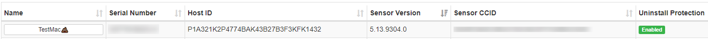
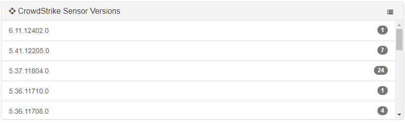
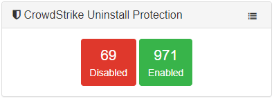

# CrowdStrike Falcon Module for Munkireport

This module gives info on the CrowdStrike Falcon sensor for a given machine. The data comes from the `/Applications/Falcon.app/Contents/Resources/falconctl stats` command.

Version 3.0 is required for CrowdStrike sensor versions 6.11 and greater. Use version 2.3 for older sensor versions.

  
Included are widgets for sensor versions:  
  
and for uninstall protection:  

## Overview

Enhanced CrowdStrike Falcon module for MunkiReport providing comprehensive security and compliance monitoring across macOS clients.

## Features

- **Core Monitoring**: Agent status, sensor versions, uninstall protection
- **Security Monitoring**: Full Disk Access, system extensions, network filters, web filters
- **Operational Health**: Cloud connectivity, heartbeat monitoring, RFM detection
- **Compliance Scoring**: Server-side global status calculation for fleet health assessment

## Table Schema

The module collects the following data fields:

### Core Fields (v4.1)
* sensor_id - VARCHAR(255) - Unique host ID of the client's sensor
* sensor_version - VARCHAR(255) - Version of the client's sensor
* customer_id - VARCHAR(255) - The customer ID checksum (CCID) for the sensor's instance
* sensor_operational - INT(11) - Boolean value for the sensor operational status. 1=Enabled 0=Disabled
* sensor_installguard - INT(11) - Boolean value for the sensor's uninstall protection policy. 1=Enabled 0=Disabled
* sensor_active - INT(11) - Boolean value for the sensor active status. 1=Enabled 0=Disabled
* system_extension_present - INT(11) - Boolean value for system extension presence. 1=Present 0=Absent
* system_extension_activated - INT(11) - Boolean value for system extension activation. 1=Activated 0=Not Activated
* installed - INT(11) - Installation status (null=legacy, 1=installed, 0=not installed)

### Enhanced Security Fields (v5.0.0)
* falcon_full_disk_access - INT(11) - Boolean value for Full Disk Access status. 1=Granted 0=Denied
* falcon_system_extension_approved - INT(11) - Boolean value for system extension approval status. 1=Approved 0=Not Approved
* falcon_network_filter_active - INT(11) - Boolean value for network filter status. 1=Active 0=Inactive
* falcon_web_filter_active - INT(11) - Boolean value for web filter status. 1=Active 0=Inactive
* falcon_service_management_configured - INT(11) - Boolean value for service management configuration. 1=Configured 0=Not Configured
* falcon_team_id_valid - INT(11) - Boolean value for team ID validation status. 1=Valid 0=Invalid
* falcon_non_removable_extension - INT(11) - Boolean value for non-removable extension status. 1=Non-removable 0=Removable
* falcon_rfm_status - INT(11) - Boolean value for Reduced Functionality Mode status. 1=RFM Active 0=Normal
* falcon_safe_mode - INT(11) - Boolean value for safe mode detection. 1=Safe Mode 0=Normal Mode
* falcon_cloud_connected - INT(11) - Boolean value for cloud connectivity status. 1=Connected 0=Disconnected
* falcon_heartbeat_active - INT(11) - Boolean value for heartbeat monitoring status. 1=Active 0=Inactive
* falcon_network_traffic_filtering - INT(11) - Boolean value for network traffic filtering status. 1=Active 0=Inactive
* falcon_macos_compatible - INT(11) - Boolean value for macOS compatibility status. 1=Compatible 0=Incompatible
* falcon_installation_paths_valid - INT(11) - Boolean value for installation path validation. 1=Valid 0=Invalid
* falcon_global_status - INT(11) - Calculated global compliance score. 1=OK 0=Issues

## Global Status

The module automatically calculates a global compliance score (0 or 1) based on 14 fields:

**Fields that must be 1 for OK status (12 total):**
- Sensor active
- Install protection enabled
- Full Disk Access granted
- System extension approved
- Network filter active
- Web filter active
- Service management configured
- Team ID valid
- Non-removable extension
- Cloud connected
- Heartbeat active
- Network traffic filtering
- macOS compatible
- Installation paths valid

**Fields that must be 0 for OK status (2 total):**
- RFM status (Reduced Functionality Mode)
- Safe mode

**Calculation Logic:**
- Status = 1 (OK) when ALL 12 positive fields are 1 AND ALL 2 negative fields are 0
- Status = 0 (Issues) when ANY field has incorrect value
- Calculation happens server-side when data is processed
- Only calculates for devices where CrowdStrike is installed (installed = 1)

## Widgets

15 comprehensive widgets for monitoring:

### Core Status Widgets
- **Global Status Overview** - Fleet-wide compliance summary
- **Sensor Active** - Active sensor count and status
- **Uninstall Protection** - Protection status across devices
- **System Extensions** - Extension presence and activation

### Security Compliance Widgets
- **Full Disk Access** - TCC permission status
- **System Extension Approved** - Extension approval status
- **Network Filter Active** - Network filtering status
- **Web Filter Active** - Web filtering status
- **Service Management** - Service configuration status
- **Team ID Valid** - Team ID validation status

### Operational Health Widgets
- **RFM Status** - Reduced Functionality Mode detection
- **Cloud Connected** - Cloud connectivity status
- **Heartbeat Active** - Heartbeat monitoring status
- **Sensor Versions** - Version distribution graph
- **Network Traffic Filtering** - Traffic filtering status

## Version History

- **v5.0.0**: Major enhancement with comprehensive security and compliance monitoring, 16 new fields, 15 widgets, and server-side global status calculation
- **v4.1**: Latest GitHub release - fixes for sensor operational and installguard booleans
- **v4.0**: General rewrite with YAML widgets and listing
- **v3.9**: Sensor operational data fixes
- **v3.8**: New sensor operational data and widgets
- **v3.0**: v6 sensor support
- **v2.3**: Locale and tooltip fixes

## License

MIT License - see LICENSE file for details.
